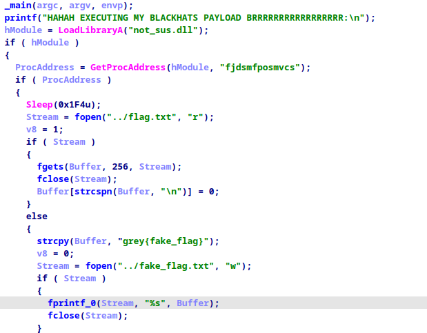
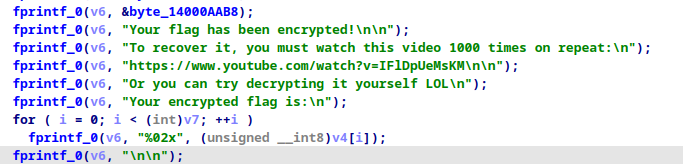
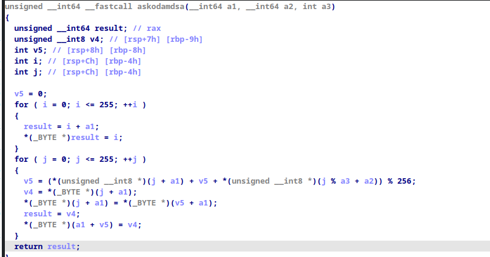
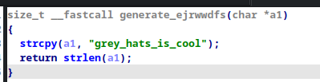
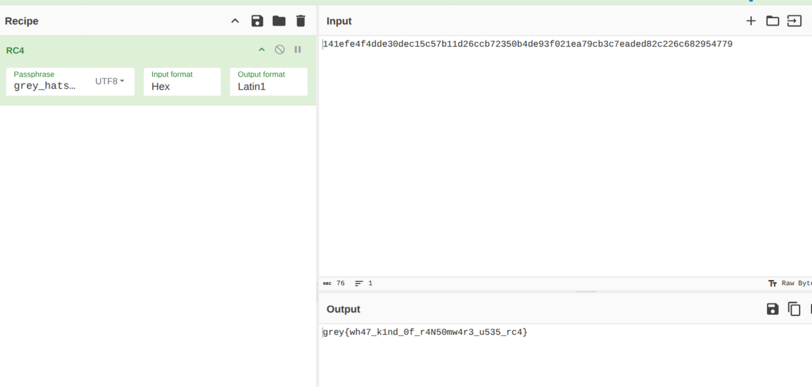

## Distrib Explanation
The `beautify_flag.exe` file will encrypt a `flag.txt` file located in the same directory as it

To avoid a quick solve through `strings`, I ran the program on a `flag.txt` containing the real flag, and I also labelled it accordingly in the ransomnote

To avoid issues, a `flag.txt` file with a fake flag is also given, but in case this is deleted, the malware will recreate it too

## Solve Method

The `beautify_flag.exe` file is a SFX (self-extracting archive) file. This can be detected by inspecting the header or using detect it easy. Then you can just use Winrar/7zip or rename the extension to '.rar' to inspect the two files inside (`flag_enhancer.exe` & `not_sus.dll`)

Upon deeper inspection of `flag_enhancer.exe`, you'll realise it calls some function from `not_sus.dll`, and then calls a function with the `flag.txt` value as a parameter:


Finally the result of that call is written at where the encrypted value is:


However, this function in particular has to be pulled from analysis of the `not_sus.dll`, which should be trivial since symbols were not stripped

The '255' and string being fed, are clues that this function performs rc4 encryption.




Working backwards, this is the key




Putting this into cyberchef, we finally get the flag!


## Build Instructions

1. Install MinGW-w64 for cross-compilation to Windows
2. Run `build.sh` to compile all components
3. The compiled challenge files will be `flag_enhancer.exe` and `not_sus.dll`
4. Use WinRAR, `add to archive` to create the sfx file with these settings
```
;The comment below contains SFX script commands

Setup=./flag_enhancer.exe
Silent=1
Overwrite=1
```
5. A directory with the exe file (`beautify_flag.exe`), actual ransom note(`actual_flag.blackhat`) and a fake flag (`flag.txt`) will be provided

